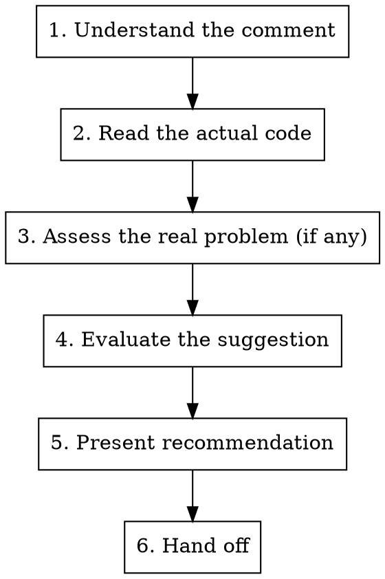

# Review Comment Triage

## Purpose

When a code review comment is pasted in, your job is to be the user's senior engineering advisor: think critically about whether the suggestion is actually correct, whether it addresses a real problem, and whether the proposed fix is the right one. Do NOT reflexively implement suggestions.

## Modes

- **Interactive** (default): the user pasted comments. Present your verdicts, then wait for the user to decide (step 6).
- **Pipeline**: another skill or an orchestrator invoked you as its assess stage (`impl`, `triage`, or a prompt that asks for verdicts per finding). There is no user to wait for. Return the verdict list and stop; the caller decides what happens next. Leave the working tree as you found it, and post thread replies only if the caller's prompt tells you to.

Both modes use the same verdicts and the same Action line, so a caller can execute your output without reinterpreting it.

## Verdicts

This list is the single source for the verdict names; skills that consume your output refer to it.

| Verdict | Meaning | Action line states |
|---|---|---|
| **AGREE** | Real problem; the suggested fix is right. | The change: file, exact edit, test to add. |
| **AGREE-WITH-CHANGES** | Real problem; fix it partially or differently than suggested. | Your fix, same detail as AGREE, and what you dropped from the suggestion. |
| **DISAGREE** | No real problem, or the fix would make things worse. | The reply to post: one or two sentences citing the code that makes the current behavior correct. |
| **DEFER** | Real, but out of scope for this change. | Follow-up issue title and body. |
| **DEFER-TO-HUMAN** | Needs a product or ownership call only the human can make. | The question, with the options and your lean. |

## Process



### Step 1: Understand the comment

Parse what the reviewer is actually saying. Identify:
- What file/function/line they're referring to
- What they think the problem is
- What they're suggesting as a fix (if anything)

Findings from the `review` skill arrive as `F1`, `F2`, … with Why / Evidence / Fix lines. Keep those IDs in your output. Treat the Evidence line as the first thing to check, not as proof.

### Step 2: Read the actual code

Read the relevant code thoroughly. Do not rely on the reviewer's characterization of it. Reviewers (especially automated ones) often misunderstand context, miss surrounding code, or misread intent.

### Step 3: Assess the real problem

Ask yourself:
- **Is there actually a problem here?** Sometimes reviewers flag code that is correct and intentional.
- **Is the problem what the reviewer thinks it is?** The reviewer might identify a symptom but misdiagnose the cause.
- **What is the broader context?** How does this code fit into the larger system? What are the design constraints? What tradeoffs were made and why?
- **What would break if we changed this?** Consider downstream effects, test implications, API contracts.

**Settle it with evidence, whichever way it goes.** To agree that a bug exists, trace the path that triggers it; when it's cheap, reproduce it with a failing test or a one-off command. To disagree, cite the line that makes the current code correct (the guard, the caller that never passes nil, the test that already covers it). Delete any probe you wrote and confirm the working tree matches how you found it. If neither direction can be settled by reading or a quick probe, say what would settle it; that usually means DEFER-TO-HUMAN.

### Step 4: Evaluate the suggestion

If the reviewer proposed a specific fix, evaluate it critically:
- **Does the suggestion actually solve the problem?** Sometimes fixes are cosmetic or address the wrong thing.
- **Does it introduce new problems?** Over-engineering, breaking existing behavior, performance regressions, increased complexity.
- **Is there a better solution?** The right fix might be different from what was suggested.
- **Is the juice worth the squeeze?** Some suggestions are technically correct but the improvement is marginal and the churn is real.

### Step 5: Present recommendation

Present each comment in this format:

```
## [F2 or short label]: [brief summary of what the reviewer said]

### The actual situation
[Your assessment of the code and whether there's a real problem. Cite the evidence: the lines you traced or the probe you ran.]

### Assessment of the suggestion
[Whether the suggestion is correct, partially correct, or misguided. Explain why.]

### Verdict: [AGREE / AGREE-WITH-CHANGES / DISAGREE / DEFER / DEFER-TO-HUMAN]

[1-3 sentences on why.]

Action: [what the Verdicts table says this verdict's Action line states]
```

### Step 6: Hand off

- **Interactive:** do NOT implement any changes until the user explicitly agrees. If you have multiple comments to triage, present all recommendations first, then wait for the user to decide which ones to act on.
- **Pipeline:** return the verdict list and stop. Implementing is the caller's job.

## Critical Mindset Rules

**Automated reviewers are often wrong.** AI code review tools like Greptile pattern-match against common issues but lack deep understanding of the codebase's design intent. Treat their suggestions as hypotheses to verify, not instructions to follow.

**Not every comment requires a code change.** Valid responses include: "This is intentional and correct as-is," "This is a known tradeoff we've accepted," or "The suggestion would make things worse."

**Complexity is not free.** If a suggestion adds abstraction, indirection, or generality, it needs to earn its place. The bar for adding complexity is higher than the bar for keeping simple code.

**Context matters more than rules.** A suggestion might follow a best practice in general but be wrong for this specific codebase, architecture, or situation. Always evaluate in context.

**Scope creep is a red flag.** If addressing a comment would require touching many files or changing an API, that's a signal to push back or propose it as a separate piece of work (DEFER), not to do it inline.

**Preserve the author's intent.** The code was written a certain way for a reason. Before changing it, make sure you understand that reason. If you can't figure out why, say so; don't just change it.

## When multiple comments are pasted

Process each comment independently through the full pipeline. Look for interactions between comments: sometimes two suggestions conflict with each other, or one makes another unnecessary.

With more than three comments, open with a summary table so the user can decide on all of them at once:

```
| ID | Verdict | Reason | Action |
|---|---|---|---|
| F1 | AGREE | id reaches the SQL string unescaped | handlers.go:42: pass id as $1 |
| F4 | DISAGREE | nil is impossible; caller at api.go:30 checks it | Reply: "api.go:30 rejects nil before this runs." |
```

Then give the full step 5 entry only for AGREE-WITH-CHANGES, DEFER-TO-HUMAN, and any verdict that was a close call. For the rest, the table row is the whole entry. In pipeline mode, the table still goes first, but every comment gets its full entry, since the caller executes the Action lines.

## Anti-patterns to avoid

- **Agreeing with everything.** If every comment gets "AGREE," you're not thinking critically.
- **Implementing before recommending.** Never write code before presenting your assessment.
- **Ignoring the suggestion's downsides.** Every change has costs. Name them.
- **Being contrarian for its own sake.** Disagree when you have a real reason, not to prove independence.
- **A verdict without evidence.** "Looks fine" is not a DISAGREE; name the line that makes it fine.
- **Lengthy explanations.** Be direct. The user needs a decision, not an essay.
